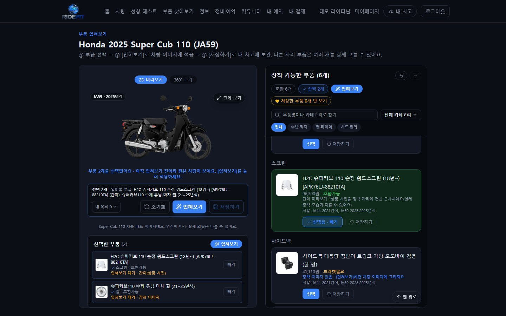
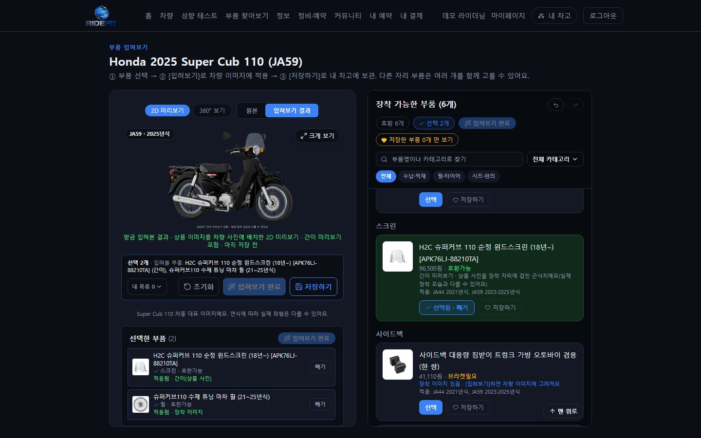
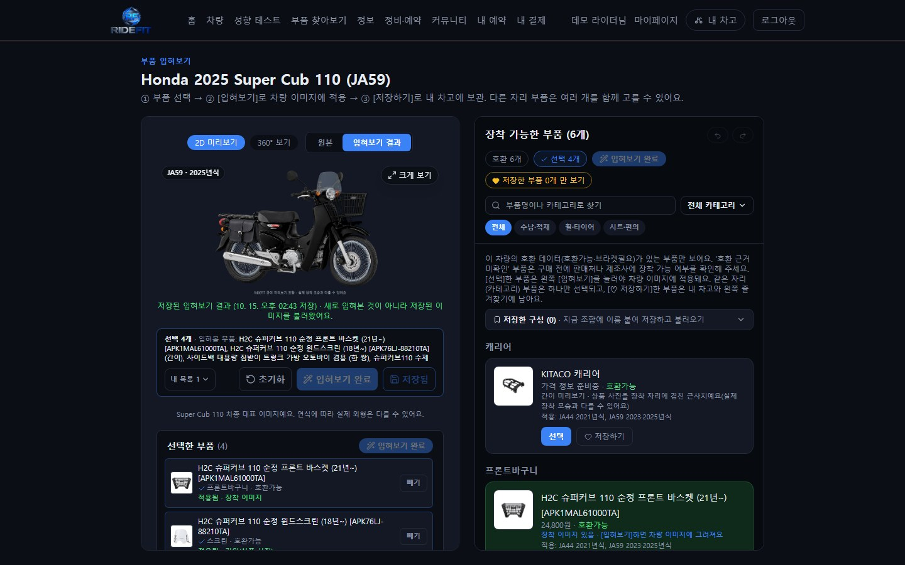
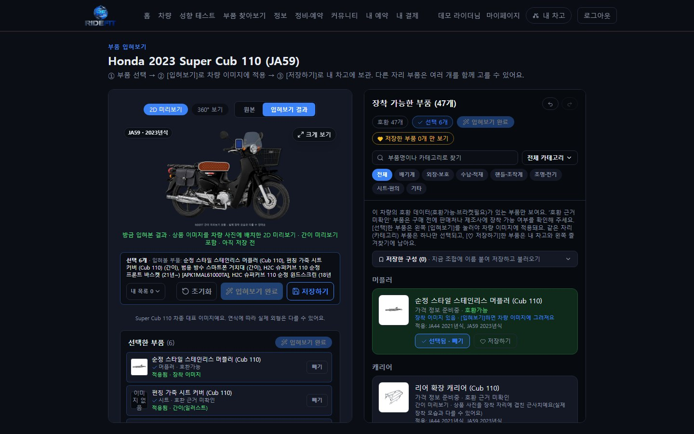
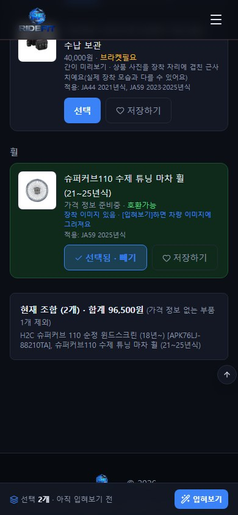
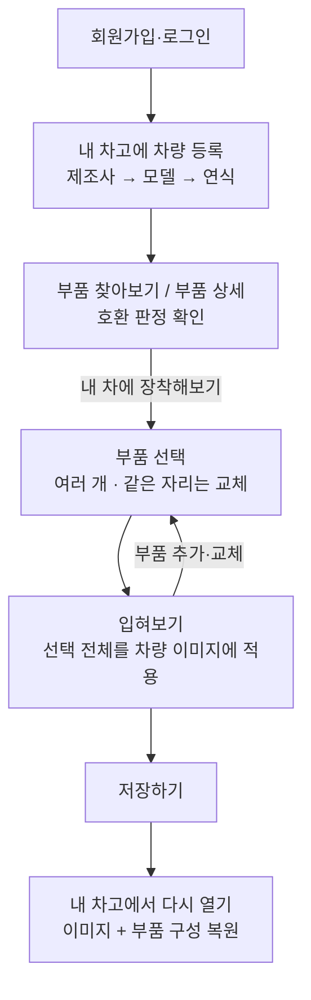
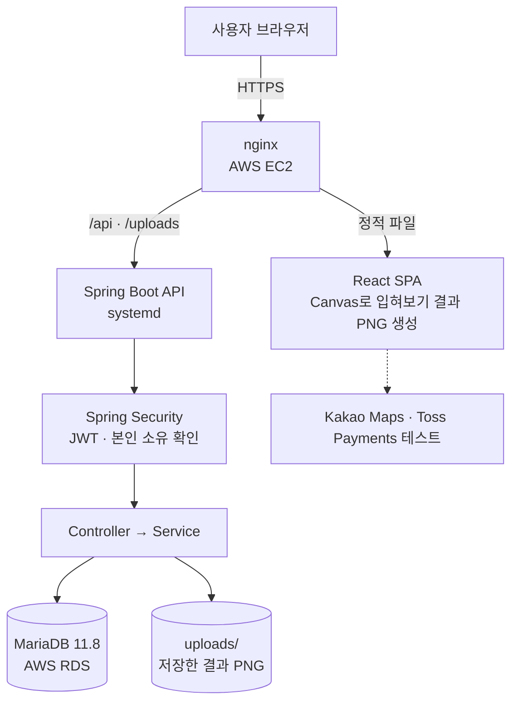
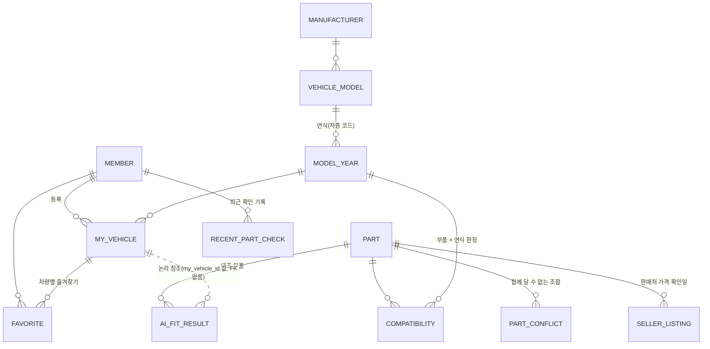

<div align="center">

# RIDEFIT

**오토바이 부품 호환성을 확인하고, 내 차량에 장착한 모습을 2D로 미리 살펴볼 수 있는 웹 서비스**

[](https://ridefit.3-34-197-34.sslip.io)


-2D3436?style=flat-square&logo=mariadb&logoColor=white)

**[서비스 바로가기](https://ridefit.3-34-197-34.sslip.io)** · [주요 화면](#주요-화면) · [문제 해결 경험](#주요-구현-및-문제-해결-경험) · [실행 방법](#실행-방법)

</div>


<p align="center"><sub>부품 4개(휠·윈드스크린·앞바구니·사이드백)를 고르고 [입혀보기]를 한 번 눌러 차량 이미지에 적용한 실제 화면</sub></p>

| 핵심 기능 | 내용 |
| --- | --- |
| **호환성 확인** | 내 차량(제조사·모델·연식)을 등록하면 그 연식과 호환되는 부품만 보여 주고, 부품 상세에서 판정 결과와 근거를 보여 줍니다. |
| **2D 입혀보기** | 부품을 여러 개 골라 [입혀보기]를 누르면 선택한 부품 전체가 차량 사진 위에 그려집니다. 슈퍼커브 110 중심으로 구현했습니다. |
| **저장·다시 보기** | 입혀 본 결과 이미지와 부품 구성을 저장하고, 내 차고에서 다시 열면 같은 이미지와 부품 선택이 복원됩니다. |

---

## 목차

1. [프로젝트 소개](#프로젝트-소개)
2. [서비스 데모](#서비스-데모)
3. [주요 기능](#주요-기능)
4. [주요 화면](#주요-화면)
5. [사용자 이용 흐름](#사용자-이용-흐름)
6. [기술 스택](#기술-스택)
7. [시스템 아키텍처](#시스템-아키텍처)
8. [데이터베이스 및 API 구조](#데이터베이스-및-api-구조)
9. [주요 구현 및 문제 해결 경험](#주요-구현-및-문제-해결-경험)
10. [테스트 및 검증 결과](#테스트-및-검증-결과)
11. [실행 방법](#실행-방법)
12. [프로젝트 범위와 한계](#프로젝트-범위와-한계)
13. [향후 개선 계획](#향후-개선-계획)

---

## 프로젝트 소개

오토바이 애프터마켓 부품은 이름이 같아도 연식에 따라 맞지 않는 경우가 많고, 그 정보가 판매처 설명·커뮤니티 글·후기에 흩어져 있습니다.
또 부품을 사기 전에는 내 차에 달았을 때 어떤 모습일지 알기 어렵습니다. RIDEFIT은 이 두 가지를 한곳에서 확인하도록 만든 개인 프로젝트입니다.

| 사용자가 겪는 문제 | RIDEFIT의 해결 |
| --- | --- |
| 이 부품이 내 차(연식)에 맞는지 매번 판매자에게 물어야 한다 | 차량을 한 번 등록하면 그 연식의 호환 데이터(호환가능·브라켓필요)가 있는 부품만 보여 준다 |
| 장착하면 어떤 모습일지 상상만 해야 한다 | 고른 부품을 차량 사진에 입혀 보고, 원본과 결과를 비교한다 |
| 마음에 든 조합을 기억해 두기 어렵다 | 결과 이미지와 부품 구성을 저장하고 내 차고에서 다시 연다 |
| 가격·판매처 정보의 출처가 불분명하다 | 판매처별 확인 가격과 확인일을 함께 보여 주고, 출처 없는 가격은 "가격 정보 준비중"으로 표시한다 |

**담당 역할 (개인 프로젝트)**

- 서비스 기획과 요구사항 정의, 사용자 흐름과 UI/UX 개선 방향 설정
- 주요 기능의 테스트 시나리오 작성·검토와 브라우저 기반 검증 결과 확인
- AI 코딩 도구를 활용한 구현·디버깅·테스트 진행과 결과 검토
- AWS(EC2 + RDS) 배포와 배포 전후 점검

---

## 서비스 데모

**https://ridefit.3-34-197-34.sslip.io**

- 회원가입 후 내 차고에 차량을 등록하면 부품 입혀보기를 쓸 수 있습니다. 공개 서버라 데모 계정은 따로 제공하지 않습니다.
- 2D 장착 미리보기가 가장 잘 보이는 차량은 **Honda Super Cub 110 2025(JA59)** 와 **2023(JA59)** 입니다.
- 결제는 Toss Payments **테스트 모드**만 연결되어 있습니다.
- 개인 학습용 서버라 데이터가 초기화되거나 서비스가 일시적으로 중단될 수 있습니다.

---

## 주요 기능

| 기능 | 설명 |
| --- | --- |
| 차량 등록·관리 | 제조사 → 모델 → 연식(차종 코드 포함, 예: 2025 Super Cub 110 JA59)으로 등록하고 차량별 대표 사진을 자동 적용 |
| 부품 검색·상세 | 내 차량 기준 카테고리별 호환 부품, 적용 연식, 판매처별 확인 가격·확인일, 설치 영상, 후기 |
| 호환성 확인 | 부품×연식 단위 판정(호환가능 / 브라켓필요 / 호환불가 / 정보없음). 근거 메모가 없는 "호환가능"은 "호환 근거 미확인"으로 따로 표시. 함께 달 수 없는 부품 조합(충돌) 경고 |
| 부품 선택과 조합 | 다른 자리 부품은 여러 개 함께 선택, 같은 자리 부품은 자동 교체. 실행 취소·다시 실행, 이름 붙인 구성 저장 |
| 2D 입혀보기 | [입혀보기]를 누르면 선택한 부품 전체를 차량 사진과 같은 좌표계의 투명 레이어로 그린 PNG를 만들어 표시. 선택이 바뀌면 "이전 선택으로 만든 결과"로 표시하고 다시 입혀보기 전까지 저장을 막음 |
| 간이 미리보기 | 장착 레이어가 없는 부품은 상품 사진 근사치나 카테고리 일러스트로 그리고, 화면과 저장 이미지에 "간이 미리보기"로 표시(실제 장착 모습 아님) |
| 저장·복원·삭제 | 화면에 보인 결과 PNG를 그대로 저장. 내 차고에서 다시 열면 이미지와 부품 선택을 복원, 크게 보기, 삭제 |
| 360° 보기 | 8각도 차량 프레임 위에 각도별 부품 레이어(앞바구니·사이드백·머플러·휠). 360° 이미지가 없는 부품은 "준비 중"으로 표시 |
| 인증·접근 제어 | JWT 인증. 차량·즐겨찾기·저장 결과는 서버에서 본인 소유를 확인(다른 회원 데이터 403/404) |
| 기타 | 즐겨찾기, 성향 테스트(차량 추천), 정비 정보·가이드, 정비소 지도(Kakao), 커뮤니티, 테스트 결제, 관리자 화면 |

---

## 주요 화면

모두 실제 서비스를 로컬에서 실행해 캡처한 화면입니다(편집 없음, 임시 계정). 01~03은 2026-10-14, 나머지는 '입혀보기' 흐름으로 바뀐 뒤인 2026-10-15에 캡처했습니다.

| 홈 | 부품 찾아보기 |
| --- | --- |
|  |  |
| **부품 상세 (호환 판정·판매처 가격)** | **입혀보기 - 부품 선택 전** |
|  |  |

**입혀보기 흐름**

| ① 휠·윈드스크린 선택 (아직 원본 차량) | ② [입혀보기] 결과 |
| --- | --- |
|  |  |
| **③ 내 차고에서 다시 연 결과 (저장된 이미지임을 표시)** | **360° 보기 (각도별 이미지가 있는 부품만 반영)** |
|  |  |

**내 차고** - 등록한 차량, 현재 구성, 저장한 입혀보기 결과를 한곳에서 보고, 결과를 크게 보거나 다시 열 수 있습니다.

<p align="center"></p>

**간이 미리보기** - 실제 장착 레이어(머플러·앞바구니·사이드백)와 근사치(상품 사진·일러스트)를 함께 입혀 본 2023년식 화면입니다. 근사치는 화면과 저장 이미지에 "간이 미리보기"로 표시됩니다.



<p>

&nbsp;

</p>

모바일(390px)에서는 부품 목록을 내려 차량이 화면 밖에 있으면 화면 아래에 [입혀보기] 바가 나타나고(왼쪽), 누르면 결과 위치로 이동합니다(오른쪽).

---

## 사용자 이용 흐름



화면별 세부 흐름(버튼 역할, 이전 결과 표시, 호환되지 않는 차량 처리)은 [docs/FEATURE_FLOWS.md](docs/FEATURE_FLOWS.md)에 정리했습니다.

---

## 기술 스택

| 구분 | 기술 | 프로젝트에서 한 일 |
| --- | --- | --- |
| 프런트엔드 | React 19, React Router 7, Vite 8, Tailwind CSS 3 | 화면, 2D 입혀보기 무대, Canvas로 결과 PNG 생성 |
| 백엔드 | Java 21, Spring Boot 4.1 (Web MVC, Data JPA, Security, Validation) | REST API, 호환성 판정, 결과 저장, 접근 제어 |
| 인증 | Spring Security + JWT(jjwt 0.12), BCrypt | 로그인 상태 유지, 회원 id는 토큰에서만 결정 |
| DB | MariaDB 11.8 (운영, AWS RDS) · MySQL 8 (로컬) · H2 (테스트) | 회원·차량·부품·호환·저장 결과 |
| 이미지 | 서버 디스크 `uploads/`(저장 결과), `frontend/public/assets`(차량·부품·레이어) | 저장 결과 PNG, 정적 레이어 |
| 배포 | AWS EC2(nginx + systemd), AWS RDS | nginx가 화면 정적 파일 제공, `/api`·`/uploads`는 Spring Boot로 전달 |
| 외부 연동 | Kakao Maps JS SDK, Toss Payments(테스트), Jsoup | 정비소 지도, 테스트 결제, 판매 링크 정보 가져오기 |
| 검증 | JUnit 5, MockMvc, Playwright(headless Chromium), oxlint | 서버 테스트, 화면 크기별 브라우저 회귀 |

---

## 시스템 아키텍처



**입혀보기 결과 저장 흐름 (외부 이미지 API 호출 없음)**

1. 화면이 선택한 부품의 배치 표(`vehicleFitPositions.js`)로 차량 원본 해상도 Canvas에 레이어를 그려 PNG를 만들고, 그 이미지를 그대로 보여 줍니다(`lib/fitComposite.js`, `lib/useFitComposite.js`).
2. [저장하기]를 누르면 **화면에 보인 그 PNG**를 차량 id·부품 id와 함께 `POST /api/ai-fit/composite`로 올립니다.
3. 서버는 본인 차량인지, 부품이 그 연식과 호환되는지, PNG 형식·비율·해상도를 확인하고 저장합니다(`AiFitService.saveComposite`).
4. 같은 회원·같은 차량·같은 조합은 기존 결과를 재사용하고, 다시 열면 이미지와 부품 id 목록으로 선택을 복원합니다.

> API 경로의 `ai-fit`은 초기 설계의 이름이 남은 것이며, 입혀보기 저장은 AI를 사용하지 않는 2D 합성입니다.

자세한 구조: [docs/ARCHITECTURE.md](docs/ARCHITECTURE.md)

---

## 데이터베이스 및 API 구조



실선은 JPA 연관관계(외래키)이고, 점선은 외래키 없이 id 값만 저장하는 논리적 참조입니다(`ai_fit_result.my_vehicle_id`, 회원 id도 같은 방식). 소유자 확인은 서버 코드에서 합니다.

| API | 설명 | 접근 |
| --- | --- | --- |
| `GET /api/my-vehicles/{id}/compatible-parts` | 내 차량 연식에 장착 가능한 부품(호환가능·브라켓필요) | 본인 차량 |
| `GET /api/parts/{id}` | 부품 상세(`?myVehicleId=`이면 그 차량 기준 비교 배지). 조회수 +1 | 공개 / 본인 차량 |
| `GET /api/parts/{id}/check?myVehicleId=` | 호환성 판정 + 최근 확인 기록 | 본인 차량 |
| `POST /api/ai-fit/composite` | 입혀보기 결과 PNG 저장(multipart) | 본인 차량 + 호환 부품 |
| `GET /api/ai-fit/results?myVehicleId=` | 저장한 결과 목록 | 본인 차량 |
| `DELETE /api/ai-fit/results/{id}` | 저장 결과 삭제(파일 포함) | 본인 결과 |
| `GET·POST /api/me/favorites` | 차량별 즐겨찾기 조회·추가 | 본인 |
| `DELETE /api/me/favorites/{partId}` | 즐겨찾기 해제(`?myVehicleId=` 차량 기준) | 본인 |

전체 API는 로컬 실행 시 Swagger UI(`/swagger-ui/index.html`)에서 볼 수 있습니다.

---

## 주요 구현 및 문제 해결 경험

### 1. 부품을 골라도 "무엇이 장착된 결과인지" 알 수 없던 문제

- **문제** - 부품을 누르는 즉시 차량 위에 겹쳐 그리는 방식이라 선택과 결과가 구분되지 않았습니다. 윈드스크린처럼 작고 투명한 부품은 변화가 거의 보이지 않았고, 모바일에서는 버튼을 누르는 순간 차량이 화면 밖에 있었습니다. 2023년식처럼 휠이 호환되지 않는 차량에서도 부품 상세에 "장착해보기"가 그대로 보였습니다.
- **원인** - 선택 상태와 결과 이미지가 같은 상태 하나로 묶여 있었고, 부품 상세의 차량 선택 목록이 호환 여부를 확인하지 않았습니다.
- **해결** - 선택(`activePartIds`)과 입혀보기 결과를 분리했습니다(`lib/useFitComposite.js`, `components/FitResultStage.jsx`). [입혀보기]를 누르면 선택 전체로 PNG를 만들고, 결과에는 "어떤 선택으로 만들었는지"를 함께 남깁니다. 선택이 바뀌면 이전 결과를 흐리게 하고 저장을 막습니다. 버튼은 차량 아래·부품 목록·선택한 부품 패널과 모바일 하단 바에 두었고, 차량 선택 목록은 차량별 호환 여부를 표시해 호환되지 않는 차량은 고를 수 없게 했습니다.
- **검증** - 2025년식 6개, 2023년식 47개 호환 부품을 하나씩 입혀 보고 결과 이미지의 실제 픽셀 변화를 확인했습니다. 저장 이미지와 화면 결과가 픽셀 단위로 같은지도 확인했습니다(로컬 브라우저 검증 101/101, 회귀 158/158).

### 2. 부품 상세의 호환성 판정이 간헐적으로 500을 내던 문제

- **문제** - 운영(MariaDB 11.8)에서 `GET /api/parts/{id}/check`가 가끔 500을 냈고, 그때 부품 상세의 판정 칸이 사라졌습니다.
- **원인** - 서버 로그와 nginx 접근 로그를 대조하니, 500은 모두 **같은 초에** 같은 부품의 조회수를 올리는 요청과 겹쳤습니다. 판정 트랜잭션은 부품을 먼저 읽고 마지막에 `recent_part_check`에 기록을 넣는데, 이때 외래키 확인이 부품 행을 다시 읽습니다. 그 사이 조회수 증가가 부품 행을 바꾸면 MariaDB 11.8의 스냅샷 격리 검사에 걸려 오류 1020(`Record has changed since last read`)이 납니다. 로컬 MySQL 8과 테스트용 H2에는 이 검사가 없어 재현되지 않았습니다.
- **해결** - 판정은 읽기 전용으로 두고, 기록은 별도 빈(`RecentPartCheckRecorder`)이 **새 트랜잭션에서 id 참조만으로** 바로 INSERT하게 분리했습니다. 기록이 실패해도 판정 결과는 200으로 돌려주고, 로그에는 부품 id와 오류 종류만 남깁니다.
- **검증** - 기록 성공과 기록 실패 두 경우의 테스트를 추가했습니다(`CompatibilityCheckServiceTest`, `PartViewAndCheckTest`). 운영 배포 후 검증(판정·조회·동시 요청 포함 15개 항목)을 모두 통과했고, 검증 시점까지 서버 로그에 1020 오류와 5xx 응답이 없었습니다.

### 3. 조회수가 2배로 쌓이고 동시 요청에서 빠질 수 있던 문제

- **문제** - 차량을 고른 상태로 부품 상세를 열면 조회수가 2씩 올랐고, 조회수 증가가 "읽고 +1 해서 저장" 방식이라 동시 요청에서 값이 빠질 수 있었습니다.
- **원인** - 화면이 일반 상세와 차량 기준 상세를 둘 다 요청했고, 두 요청 모두 조회수를 기록했습니다.
- **해결** - 조회수와 장착 시도 수를 각각 `UPDATE … SET view_count = view_count + 1`로 바꿨습니다(`PartRepository`). 상세 API는 차량 확인을 먼저 해서 403/404 요청은 조회로 세지 않게 했고, 화면은 상세를 한 번만 요청합니다. 개발 모드의 React StrictMode 이중 실행은 운영 빌드에는 없음을 따로 확인했습니다.
- **검증** - 예전 코드로 되돌리면 동시성 테스트가 실패하고, 수정 후에는 30번 동시 기록에 정확히 +30이 됩니다. 운영에서는 차량 선택 상태의 상세 요청 1번, 조회수 +1, 403/404 미집계를 확인했습니다.

### 4. 저장 결과가 다른 회원의 결과로 열리던 문제와 접근 제어

- **문제** - 저장 결과를 재사용하는 키가 부품 조합만 보고 있어서, 다른 회원이 같은 조합을 먼저 저장했으면 새 회원의 저장이 그 결과를 돌려받았습니다.
- **해결** - 재사용 범위를 "같은 회원 + 같은 차량 + 같은 조합"으로 좁혔습니다. 회원 id는 요청 본문이 아니라 JWT로만 정하고, 차량·저장 결과·즐겨찾기 API는 서버에서 소유자를 확인합니다. 다른 차량에서 저장한 결과는 화면에서도 열지 않습니다.
- **검증** - `CompositeFitTest`, `AiFitResultDeleteTest`, `VehicleFavoriteTest`에서 다른 회원의 조회·삭제·수정이 403/404인지 확인합니다.

### 5. 지원 범위를 정직하게 보여 주기

- 차량 사진마다 부품 레이어를 실측해야 해서 2D 입혀보기는 슈퍼커브 110 대표 사진만 지원합니다. 다른 차종과 사용자가 올린 사진에서는 [입혀보기]를 막고 이유와 부착 위치만 표시합니다.
- 상품 사진 근사치·일러스트는 "간이 미리보기"로, 360° 이미지가 없는 부품은 "360° 장착 이미지 준비 중"으로 표시합니다. 저장 이미지 아래에도 같은 안내가 들어갑니다.

배포 중 겪은 문제(배포 JAR의 로컬 설정 파일 제거, MariaDB 방언 인식 등)는 [docs/TROUBLESHOOTING.md](docs/TROUBLESHOOTING.md)에 정리했습니다.

---

## 테스트 및 검증 결과

아래 수치는 표에 적은 날짜·환경에서 실제로 실행한 결과입니다. 이후 코드나 데이터가 바뀌면 다시 확인해야 합니다.

| 시점 · 환경 | 항목 | 결과 |
| --- | --- | --- |
| 2026-10-15 · 로컬(H2 테스트 DB) | 백엔드 `gradlew test` | **49 / 49 통과** (25개 클래스) |
| 2026-10-15 · 로컬 | 프런트 lint(oxlint) · 빌드 | 오류 0 · 성공 |
| 2026-10-15 · 로컬 브라우저(Playwright, 1280·390px) | 입혀보기 - 호환 부품 53개 하나씩 + 조합·저장·미지원 안내 | **101 / 101** |
| 2026-10-15 · 로컬 브라우저 | 입혀보기·저장·복원·삭제·360°·회귀 | **158 / 158** |
| 2026-10-15 · 운영(배포 직후) | 부품 상세 조회·호환 판정·403/404 (A+B+E 검증) | **15 / 15** |
| 2026-10-15 · 운영(배포 직후) | 입혀보기·저장·내 차고·모바일 회귀 | **30 / 30** (스크립트의 오래된 기대값 2건 수정 후 재실행) |
| 2026-10-15 · 운영 로그(배포 후 검증 시점까지) | 5xx 응답 · MariaDB 1020 오류 | 0건 · 0건 |

- 운영 검증은 매번 새 임시 계정으로 하고, 끝나면 앱의 삭제·탈퇴 기능으로 정리했습니다. 외부 이미지 생성 API와 결제 승인은 호출하지 않았습니다.
- MariaDB 1020 오류는 로컬에서 재현할 수 없어 운영 로그로만 확인했습니다.

날짜별 상세 기록: [docs/TESTING.md](docs/TESTING.md)

---

## 실행 방법

필요 도구: JDK 21, Node.js 18 이상(개발은 24), MySQL 8

```powershell
# 1) 백엔드 설정 파일 (커밋되지 않음) - DB 계정과 jwt.secret을 채운다
Copy-Item src/main/resources/application-local.properties.example src/main/resources/application-local.properties

# 2) 백엔드  http://localhost:8080  (Swagger: /swagger-ui/index.html)
.\gradlew.bat bootRun

# 3) 프런트엔드  http://localhost:5173
cd frontend
npm install
npm run dev
```

```powershell
.\gradlew.bat test                      # 백엔드 테스트 (H2 인메모리, 로컬 DB를 건드리지 않음)
cd frontend; npm run lint; npm run build
```

첫 실행 때 차량·부품·호환 데이터가 시드됩니다. 개발용 테스트 계정은 `ridefit.seed.demo-accounts=true`일 때만 만들어집니다. 환경 변수와 자주 나는 오류는 [docs/SETUP.md](docs/SETUP.md)에 있습니다.

---

## 프로젝트 범위와 한계

- **2D 입혀보기**는 슈퍼커브 110 대표 사진 기준입니다. 실제 장착 레이어가 있는 부품은 앞바구니·사이드백·머플러·휠이고, 나머지는 간이 미리보기(상품 사진 근사치·일러스트)라 실제 장착 모습과 다를 수 있습니다.
- **360° 보기**는 슈퍼커브 110의 앞바구니·사이드백·머플러·휠만 반영됩니다.
- **호환 데이터** 중 근거 메모가 없는 항목은 "호환 근거 미확인"으로 표시되며, 일부는 개발용 데모 값입니다. 실제 구매 전에는 판매처·제조사 확인이 필요합니다.
- **판매처 가격**은 확인일 기준 값이며 실시간 조회가 아닙니다. 결제는 테스트 모드만 지원합니다.
- **조회수**는 2026-10-15 수정 전까지 일부가 2배로 집계되었고, 기존 값은 보정하지 않았습니다.
- 운영 서버는 `index.html`에 캐시 정책이 없어 배포 직후 일부 브라우저에 이전 화면이 잠시 보일 수 있습니다.

전체 목록: [docs/LIMITATIONS.md](docs/LIMITATIONS.md)

---

## 향후 개선 계획

- 다른 차종(PCX 등) 측면 사진 기준 부품 레이어 확대와 레이어 제작 도구 정리
- `index.html`(재검증)·해시 파일(장기 캐시) 캐시 정책 적용
- 판매처 가격·판매 상태 재확인 주기화
- 저장한 결과 두 개를 나란히 비교하는 보기

---

<div align="center">

**상세 문서** · [실행·환경 설정](docs/SETUP.md) · [아키텍처](docs/ARCHITECTURE.md) · [기능 흐름](docs/FEATURE_FLOWS.md) · [테스트 기록](docs/TESTING.md) · [트러블슈팅](docs/TROUBLESHOOTING.md) · [한계와 계획](docs/LIMITATIONS.md)

</div>
