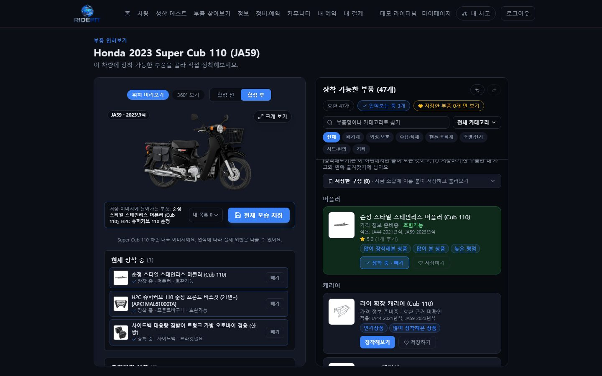
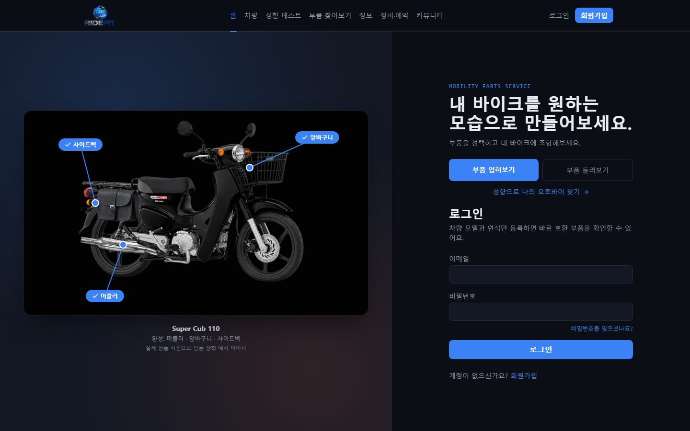
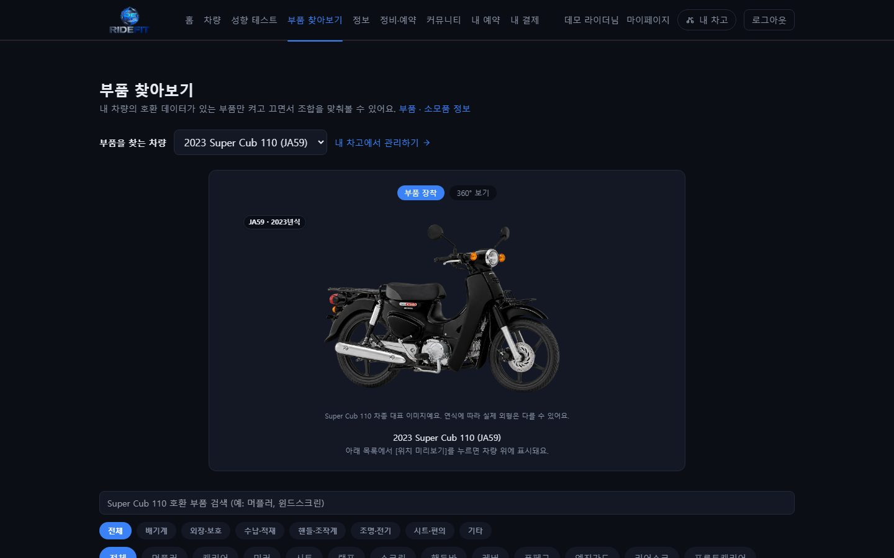
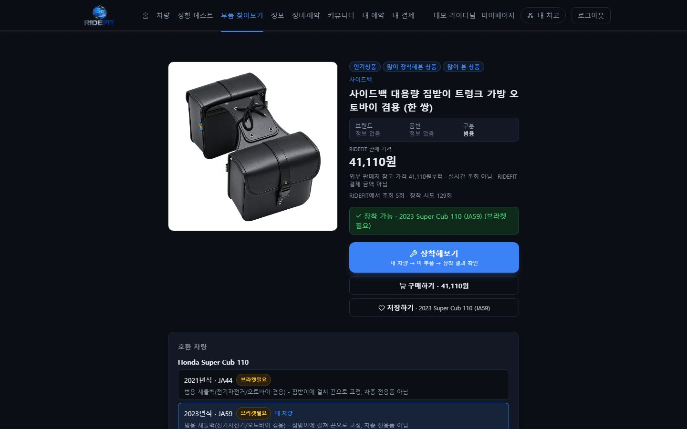
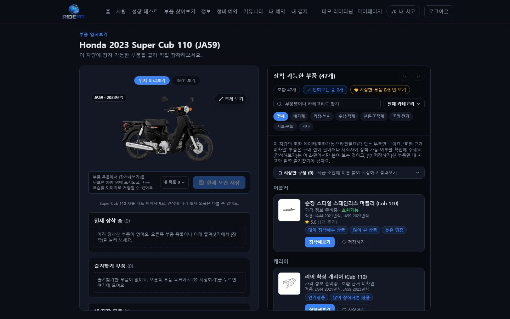
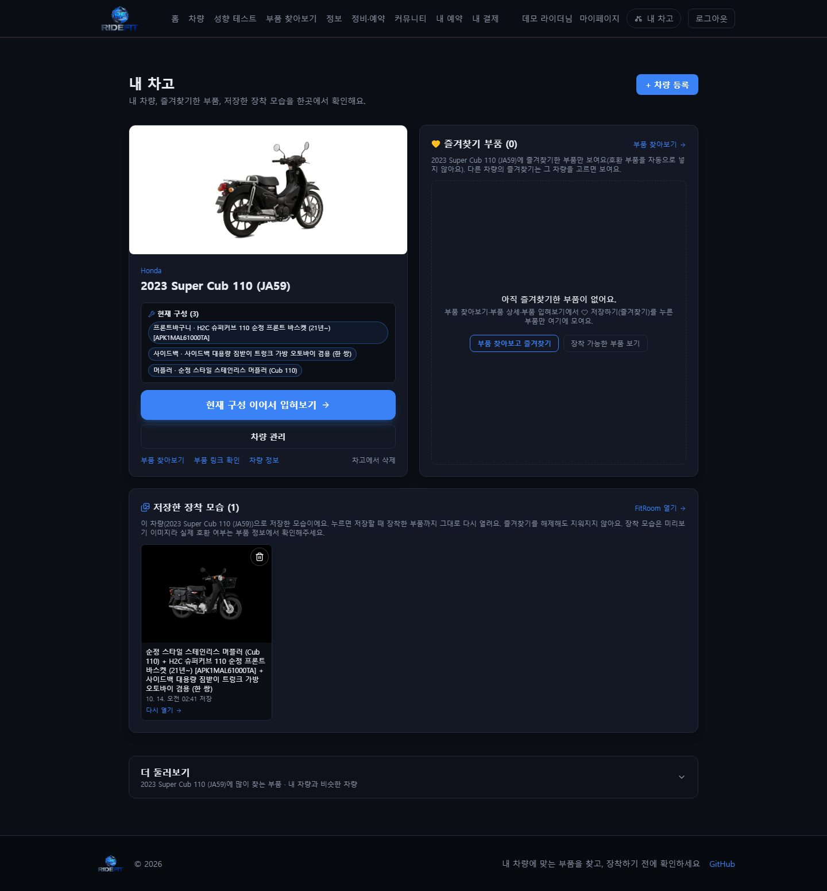
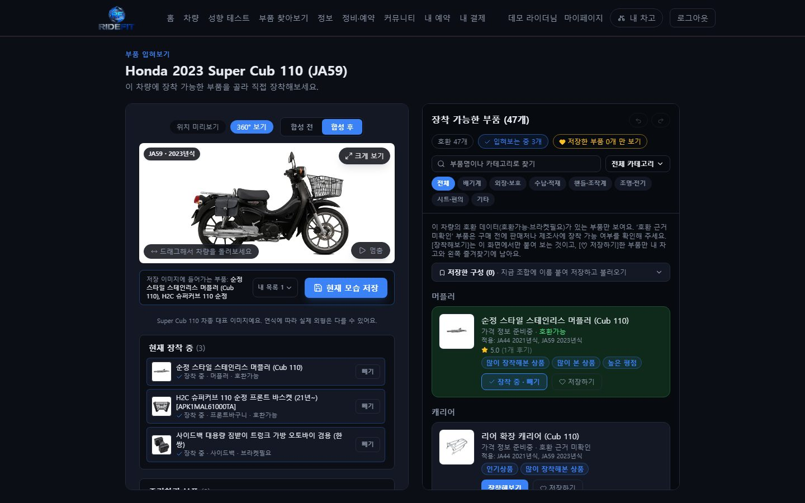
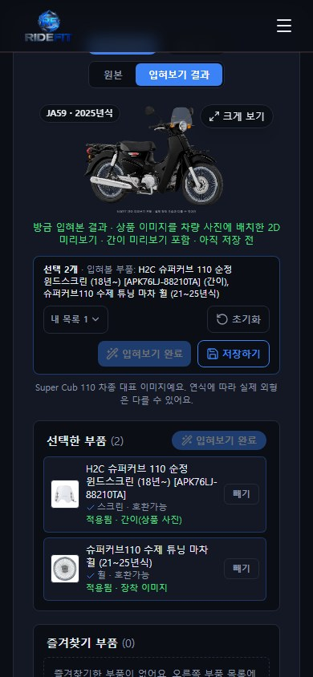
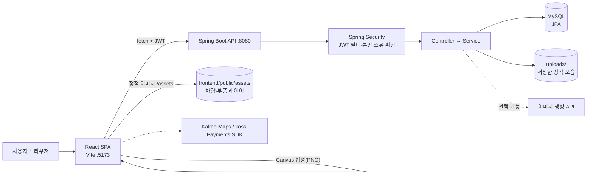

# RIDEFIT

**내 오토바이에 부품을 입혀 보고, 완성한 모습을 저장하는 부품 커스터마이징 웹 서비스**

RIDEFIT은 오토바이 사용자가 자신의 차량(제조사·모델·연식)에 맞는 부품을 찾고, 게임에서 캐릭터를 꾸미듯이
앞바구니·사이드백·머플러 같은 부품을 차량 사진 위에 직접 장착해 보고, 마음에 드는 조합을 이미지로 저장해 다시 열어 볼 수 있게 돕는 서비스입니다.



| 핵심 가치 | 내용 |
| --- | --- |
| 내 차에 맞는 부품만 | 부품-연식 호환 데이터(호환가능 / 브라켓필요 / 호환불가)로 내 차량에 장착 가능한 부품만 고른다 |
| 사기 전에 입혀 보기 | 실제 차량 사진 위에 투명 배경 부품 레이어를 겹쳐 여러 부품을 동시에 장착해 본다 |
| 조합을 남기기 | 완성한 모습을 이미지로 저장하고, 다시 열면 그때 장착한 부품까지 그대로 복원된다 |

**목차** · [주요 기능](#주요-기능) · [화면](#화면) · [기술 스택](#기술-스택) · [아키텍처](#아키텍처) · [문제 해결 경험](#문제-해결-경험) ·
[실행 방법](#실행-방법) · [테스트](#테스트) · [한계와 계획](#알려진-한계와-향후-계획) · 상세 문서: [docs/](docs/)

> 공개 데모 주소는 아직 없습니다. 로컬에서 실행하는 방법은 [docs/SETUP.md](docs/SETUP.md)에 있습니다.

---

## 프로젝트 소개

### 왜 만들었나

오토바이 애프터마켓 부품은 "같은 이름의 부품이어도 연식에 따라 안 맞는" 경우가 많고, 그 정보가 판매처 설명·커뮤니티 글·후기에 흩어져 있습니다.
또 부품을 사기 전에는 내 차에 달았을 때 어떤 모습일지 알기 어렵습니다.

### 사용자가 겪는 문제 → RIDEFIT의 해결

| 문제 | RIDEFIT |
| --- | --- |
| 이 부품이 내 차(연식)에 맞는지 매번 판매자에게 물어야 한다 | 차량을 한 번 등록하면 그 연식의 호환 데이터(호환가능·브라켓필요)가 있는 부품만 보여 준다(일부 시드 호환 데이터는 개발용 데모 값 - [한계](docs/LIMITATIONS.md) 참고) |
| 장착하면 어떤 모습일지 상상만 해야 한다 | 차량 사진 위에 부품 레이어를 겹쳐 여러 부품을 동시에 장착해 본다 |
| 마음에 든 조합을 기억해 두기 어렵다 | 완성한 모습을 저장하고 내 차고에서 다시 열면 부품 구성까지 복원된다 |
| 가격·판매처 정보의 출처가 불분명하다 | 판매처별 확인 가격과 확인일을 함께 보여 주고, 새로 넣는 시드 데이터에는 출처 없는 가격을 넣지 않는다(가격이 없으면 "가격 정보 준비중") |

### 주요 사용자 흐름

```
회원가입/로그인 → 내 차고에 차량 등록(제조사 → 모델 → 연식)
→ 부품 입혀보기(FitRoom): 호환 부품 고르기 → 장착/해제·실행 취소 → 합성 전/후 비교 → 360° 보기
→ [현재 모습 저장] → 내 차고에서 저장한 모습 다시 열기(이미지 + 장착 부품 복원)
```

---

## 주요 기능

| 기능 | 설명 | 화면 |
| --- | --- | --- |
| 차량 등록·관리 | 제조사 → 모델 → 연식(차종 코드 포함, 예: 2025 Super Cub 110 JA59)으로 등록. 차량별 대표 사진 자동 적용 | 내 차고 |
| 부품 검색·상세 | 내 차량 기준 카테고리별 호환 부품, 적용 연식, 판매처별 확인 가격·확인일, 설치 영상, 후기 | 부품 찾아보기 / 부품 상세 |
| 호환성 표시 | 부품-연식 단위 호환 데이터(호환가능 / 브라켓필요 / 호환불가), 함께 달 수 없는 부품 조합(충돌) 경고. "호환가능"인데 근거 메모가 없는 데이터는 "호환 근거 미확인"으로 따로 표시하고 판매처·제조사 확인을 안내 | 부품 찾아보기 / 부품 상세 / FitRoom / 내 차고 |
| 부품 장착 미리보기 | 차량 사진과 같은 좌표계의 투명 부품 레이어를 겹쳐 표시. 같은 자리 부품은 자동 교체, 실행 취소/다시 실행, 합성 전/후 비교 | FitRoom |
| 장착 이미지 준비 중 배지 | 레이어 이미지가 아직 없는 부품은 부착 지점 + 연결선 + 배지로 표시. 화면이 좁아 겹치면 "장착 이미지 준비 중 · N개"로 묶는다 | FitRoom |
| 360° 보기 | 8각도 차량 프레임 + 각도별 부품 레이어(앞바구니·사이드백·머플러 등). 각도마다 가려지는 부품은 그 각도에서 숨김 | FitRoom |
| 장착 모습 저장·복원 | 화면과 같은 배치를 차량 원본 해상도로 합성해 PNG로 저장(외부 API 호출 없음). 다시 열면 부품 구성 복원, 개별 삭제 | FitRoom / 내 차고 |
| 즐겨찾기 | 차량별로 직접 즐겨찾기한 부품만 모아 보기(호환 부품을 자동으로 넣지 않음). 저장한 장착 모습과는 별개 데이터 | 내 차고 / FitRoom |
| 내 차고 | 내 차량 · 즐겨찾기 부품 · 저장한 장착 모습 중심. 추천 부품·비슷한 차량은 "더 둘러보기"(접힘) | 내 차고 |
| 인증·개인 데이터 보호 | Spring Security + JWT. 차량·즐겨찾기·저장 결과는 서버에서 본인 소유를 확인(다른 회원 데이터 403/404) | 전체 |
| 기타 | 성향 테스트(차량 추천), 정비 정보·가이드, 정비소 상세(카카오 지도), 커뮤니티, Toss Payments **테스트 결제**, 관리자 화면 | 각 메뉴 |

> 이미지 합성 방식: 장착 미리보기와 저장은 미리 준비한 투명 레이어를 겹치는 **2D 직접 합성**이며 실행 중 AI를 호출하지 않습니다.
> 일부 정적 레이어(앞바구니 등)는 제작 과정에서 이미지 편집 결과를 잘라 만든 것입니다(코드 주석과 `tools/` 문서에 출처 기록).
> 레이어가 없는 부품용 "장착한 모습 만들기"(외부 이미지 생성 API 연동)는 API 키를 설정했을 때만 켜지는 선택 기능이며 기본은 꺼져 있습니다.

---

## 화면

로컬 개발 환경에서 실제 화면을 캡처한 이미지입니다(2026-10-14, 편집 없음, 임시 데모 계정).

> **가격 표기:** 출처를 확인할 수 없는 가격을 정리한 뒤 캡처해, 가격 근거가 없는 부품은 "가격 정보 준비중"으로 보입니다.
> 부품 상세(03)의 41,110원은 등록된 외부 판매처 가격을 기준으로 한 값이며 실시간 가격이 아닙니다.

| 홈 (Hero: 부품이 차례로 장착되는 소개) | 부품 찾아보기 (내 차량 기준 호환 부품) |
| --- | --- |
|  |  |
| **부품 상세 (판매처별 확인 가격·확인일)** | **FitRoom - 순정 상태** |
|  |  |
| **내 차고 (내 차량 · 즐겨찾기 · 저장한 장착 모습)** | **360° 보기 (각도별 부품 레이어)** |
|  |  |



모바일에서는 차량 미리보기와 부품 목록이 세로로 이어지고, 데스크톱에서는 왼쪽(차량 고정)과 오른쪽(부품 목록)이 각자 스크롤됩니다.

---

## 기술 스택

| 구분 | 사용 기술 |
| --- | --- |
| 프런트엔드 | React 19, React Router 7, Vite 8, Tailwind CSS 3, lucide-react, oxlint |
| 백엔드 | Java 21, Spring Boot 4.1 (Web MVC, Data JPA, Security, Validation), Lombok, springdoc-openapi(Swagger UI) |
| DB | MySQL 8 (로컬), 테스트는 H2 인메모리(MySQL 모드) |
| 인증 | JWT(jjwt 0.12, stateless), BCrypt |
| 이미지 저장 | 서버 로컬 디스크(`uploads/`, `/uploads/**`로 제공), 정적 차량·부품 이미지는 `frontend/public/assets` |
| 외부 연동 | Jsoup(부품 판매 링크 정보 가져오기), Kakao Maps JavaScript SDK(정비소 지도), Toss Payments SDK(테스트 결제), 이미지 생성 API(선택 - OpenAI/Gemini/Magic Hour, 키가 있을 때만) |
| 브라우저 검증 | Playwright(headless Chromium)로 화면 크기별 회귀 확인(저장소 밖 스크립트, [docs/TESTING.md](docs/TESTING.md)) |

---

## 아키텍처



장착 모습 저장 흐름(외부 호출 없음):

1. FitRoom이 화면과 같은 배치(차량 사진 + 부품 레이어 좌표)를 차량 원본 해상도 Canvas에 그려 PNG를 만든다(`frontend/src/lib/fitComposite.js`).
2. `POST /api/ai-fit/composite`로 차량 id·부품 id와 함께 올린다.
3. 서버가 본인 차량인지, 부품이 그 연식과 호환되는지, PNG 형식·비율·해상도를 검증하고 `uploads/ai-fit/`에 저장한 뒤 결과 행을 남긴다(`AiFitService.saveComposite`).
4. 같은 회원이 같은 차량·같은 조합을 다시 저장하면 기존 결과를 재사용한다. 다시 열기(`?result=`)는 이미지와 부품 id 목록으로 장착 상태를 복원한다.

자세한 구조와 데이터 흐름: [docs/ARCHITECTURE.md](docs/ARCHITECTURE.md)

---

## 문제 해결 경험

코드·테스트·작업 기록(`WORK_LOG.md`)으로 확인할 수 있는 내용만 정리했습니다.

- **2D 레이어 합성의 일관성** - 차량 사진과 같은 캔버스(예: 1829×860) 좌표계의 투명 레이어만 쓰고, 무대·저장 이미지·홈 Hero가 같은 배치 표(`vehicleFitPositions.js`)를 읽게 해 화면마다 부품 위치가 달라지지 않게 했다. 휠처럼 순정 부품을 지워야 하는 경우는 마스크 레이어를 함께 쓴다.
- **360° 부품 레이어** - 8각도 프레임마다 레이어를 만들고, 각도에서 실제로 보이지 않는 부품(왼쪽에서 본 오른쪽 머플러 등)은 "안 보임"으로 명시해 회전 중 부품이 깜빡이지 않게 했다(`vehicle360Parts.js`, `tools/fit-360`).
- **좁은 무대의 배지 겹침** - 배지 위치는 사진 픽셀 기준인데 배지 크기는 화면 글자 크기라 작은 화면에서 서로 겹쳤다. 실제 화면 크기로 겹침을 계산해 겹치는 배지를 묶고 부착 지점 연결선은 유지했다(`lib/fitBadges.js`).
- **저장 결과의 사용자 분리** - 저장 결과 재사용 키가 조합만 보고 있어, 다른 회원이 같은 조합을 먼저 저장했으면 새 회원의 저장이 그 결과를 돌려받던 문제를 신규 회원 시나리오 테스트로 발견해 "같은 회원 + 같은 차량"으로 좁혔다(`CompositeFitTest`에 회귀 검증 추가).
- **사용자별 데이터 접근 제어** - 회원 id는 요청 본문이 아니라 JWT로만 정하고, 차량·저장 결과·즐겨찾기 API는 서버에서 소유자를 확인한다. 일반 회원의 관리자 API 접근은 401이 아니라 403으로 응답하도록 처리했다.
- **반응형 텍스트** - `truncate`/`line-clamp`로 잘라 숨기던 부품명을 공통 `wrap-name`(한글은 단어 단위, 긴 품번만 필요할 때 끊기)으로 바꾸고, 모바일에서는 정보 배치를 세로로 바꿔 카드가 지나치게 길어지지 않게 했다.
- **데이터 신뢰성** - 출처를 확인할 수 없는 가격은 더 이상 시드하지 않고, 가격이 없는 부품은 "가격 정보 준비중"으로 표시하며 구매 버튼을 숨긴다. 판매처 가격은 확인일과 함께 보여 주고(실시간 가격 아님), 예시 판매처(`.test` 도메인)는 "예시 데이터"로 표시하고 최저가 비교에서 뺀다. 근거 메모 없는 호환 데이터는 "호환 근거 미확인"으로 구분한다. 개발 DB의 출처 없는 가격은 2026-10-14에 백업 후 정리했다(예전 시드로 만든 다른 DB는 별도 정리가 필요할 수 있다 - [한계](docs/LIMITATIONS.md)).

---

## 실행 방법

필요 도구: JDK 21, Node.js 18 이상(개발 시 24에서 확인), MySQL 8. 자세한 설정·환경 변수·자주 나는 오류는 [docs/SETUP.md](docs/SETUP.md).

```powershell
# 1) 백엔드 설정 파일 만들기(커밋 금지 - .gitignore에 포함)
Copy-Item src/main/resources/application-local.properties.example src/main/resources/application-local.properties
#    DB 계정과 jwt.secret(32바이트 이상 임의 문자열)을 채운다

# 2) 백엔드 (http://localhost:8080, Swagger: /swagger-ui/index.html)
.\gradlew.bat bootRun

# 3) 프런트엔드 (http://localhost:5173)
cd frontend
npm install
npm run dev
```

첫 실행 시 시더가 차량·부품·호환 데이터를 넣습니다. 테스트 계정(`user@ridefit.dev` 등, 비밀번호는 `DataSeeder`에 공개된 개발용 값)은 `application-local.properties`에 `ridefit.seed.demo-accounts=true`가 있을 때만 만들어집니다(기본값 false - [SETUP](docs/SETUP.md)).

---

## 테스트

```powershell
.\gradlew.bat test            # 백엔드(H2 인메모리, 로컬 MySQL을 건드리지 않음)
cd frontend; npm run lint; npm run build
```

이번 정리 작업에서 실제로 실행한 결과와 브라우저 회귀 검증 항목은 [docs/TESTING.md](docs/TESTING.md)에 날짜와 함께 기록했습니다.

---

## 알려진 한계와 향후 계획

- 장착 레이어 이미지가 준비된 부품은 아직 Super Cub 110의 앞바구니·사이드백·머플러·휠 등 일부입니다. 나머지는 "장착 이미지 준비 중" 배지로 표시합니다.
- 2025 Super Cub 110(JA59)에는 레이어가 준비된 머플러의 호환 데이터가 없어 앞바구니 + 사이드백까지만 이미지로 장착됩니다(근거 없는 호환 데이터는 넣지 않음).
- 호환 데이터 중 근거 메모가 없는 "호환가능" 89건(개발 DB 기준)은 화면에서 "호환 근거 미확인"으로 표시됩니다. 메모가 있는 데이터도 일부는 개발용 데모 값이라 실제 구매 전 확인이 필요합니다.
- 판매처 가격은 확인일 기준 값이며 실시간 조회가 아닙니다. 품절 여부는 데이터로 관리하지 않습니다.
- 결제는 Toss Payments 테스트 모드만 지원합니다.

전체 목록과 계획: [docs/LIMITATIONS.md](docs/LIMITATIONS.md)
