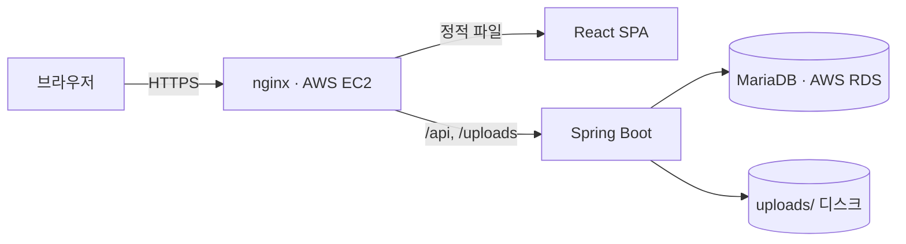
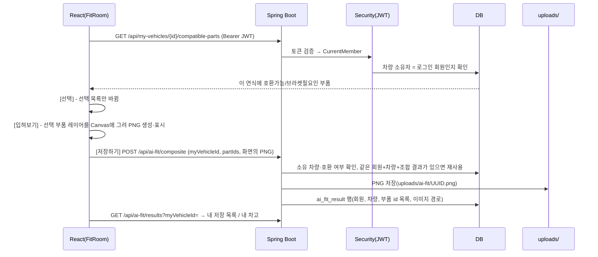
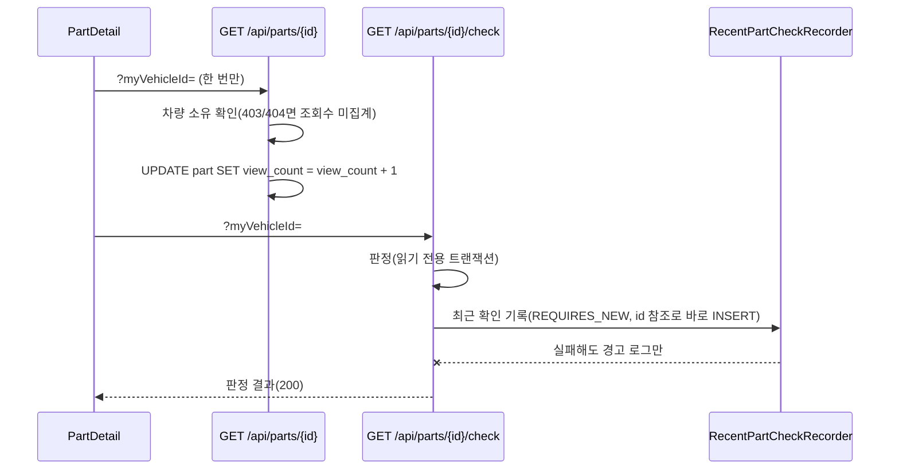

# 아키텍처와 주요 데이터 흐름

## 구성

```
ridefit/
├─ src/main/java/com/ridefit/ridefit/
│  ├─ controller/        REST API (admin/ 하위는 관리자 전용)
│  ├─ service/           비즈니스 로직 (호환성 판정, 최근 확인 기록, 입혀보기 결과 저장, 결제, 인기 통계 ...)
│  ├─ repository/        Spring Data JPA (조회수·장착 시도 수 원자적 증가 쿼리 포함)
│  ├─ domain/            JPA 엔티티 (Member, MyVehicle, Part, Compatibility, Favorite, AiFitResult, RecentPartCheck ...)
│  ├─ security/          JWT 필터, 인증 실패(401)/권한 거부(403) 응답, CurrentMember
│  └─ config/            시더(DataSeeder, ContentSeeder, VerifiedPartsSeeder), CORS, 정적 리소스(/uploads/**)
├─ frontend/
│  ├─ src/pages/         화면(FitRoom, Garage, PartsSearch, PartDetail ...)
│  ├─ src/components/    FitResultStage(입혀보기 결과 무대), VehicleFitStage(원본·부착 위치), Vehicle360Viewer, FitSavePanel ...
│  ├─ src/constants/     vehicleFitPositions.js(차종별 레이어·부착 좌표), vehicle360Parts.js(각도별 레이어)
│  ├─ src/lib/           api.js(JWT 헤더), fitComposite.js(Canvas 합성·업로드), useFitComposite.js(선택과 결과 상태), fitBadges.js
│  └─ public/assets/     차량 사진, 360 프레임, 부품 사진, 투명 부품 레이어
└─ tools/                fit-360(360 부품 레이어 제작), wheel-fit(휠 레이어 제작) 스크립트
```

## 실행 환경

| 환경 | 화면 | API | DB |
| --- | --- | --- | --- |
| 운영 | nginx가 빌드된 정적 파일 제공(HTTPS) | Spring Boot JAR (systemd 서비스), nginx가 `/api`·`/uploads`를 전달 | AWS RDS MariaDB 11.8 |
| 로컬 개발 | Vite 개발 서버 `:5173` | `gradlew bootRun` `:8080` | MySQL 8 |
| 테스트 | - | `@SpringBootTest` + MockMvc | H2 인메모리(MySQL 모드) |



- 화면 배포는 정적 파일 교체만으로 반영되고(서비스 재시작 없음), 백엔드 배포는 JAR 교체 후 서비스를 다시 시작합니다(기동 약 16~20초).
- 화면 번들 파일 이름에는 내용 해시가 붙어, 새 `index.html`로 바꾸기 전에 새 번들을 먼저 올려도 기존 화면에 영향이 없습니다.

## 입혀보기 요청 흐름



## 부품 상세의 조회수와 호환성 판정



판정과 기록을 나눈 이유는 [TROUBLESHOOTING T1](TROUBLESHOOTING.md#t1-호환성-판정-api의-간헐적-500-mariadb-1020)에 있습니다.

## 주요 개념

| 개념 | 저장 위치 | 설명 |
| --- | --- | --- |
| 호환성 | `compatibility`(부품 × 연식) | 호환가능 / 브라켓필요 / 호환불가 + 근거 메모. 장착 후보는 호환가능·브라켓필요만. 화면은 "호환가능 + 메모 없음"을 "호환 근거 미확인"으로 구분(`lib/compatStatus.js`, 판정 데이터는 그대로) |
| 최근 확인 기록 | `recent_part_check` | 호환성 판정을 할 때마다 한 건(마이페이지 "최근 확인한 부품"). 판정과 별도 트랜잭션 |
| 부품 충돌 | `part_conflict` | 함께 달 수 없는 부품 조합(예: 캐리어 + 스크린 마운트 간섭) |
| 현재 구성 | 브라우저 localStorage(차량별) | 입혀보기 화면에서 마지막으로 선택해 둔 부품. 서버 데이터 아님 |
| 즐겨찾기 | `favorite`(회원, 부품, 차량) | 사용자가 직접 ♡ 저장한 부품만. 저장한 입혀보기 결과와 별개 |
| 저장한 입혀보기 결과 | `ai_fit_result` + `uploads/ai-fit/` | 2D 합성 PNG와 부품 id 목록. 삭제 시 파일도 정리(다른 결과가 같은 파일을 쓰면 유지). 테이블·API 이름의 `ai`는 초기 설계 이름 |
| 판매처 가격 | `seller_listing` | 판매처·상품명·가격·확인일·상품 링크. `.test` 도메인은 "예시 데이터"로 표시하고 비교에서 제외 |
| 조회수 / 장착 시도 수 | `part.view_count` / `part.fit_selection_count` | 서로 다른 지표. 둘 다 DB에서 원자적으로 +1 |

## 2D 입혀보기

- 차종 대표 사진마다 `VEHICLE_FIT_LAYOUTS`에 사진 크기, 부품 레이어 배치(`overlays`), 레이어 없는 부품의 부착 지점(`anchors`), 간이 미리보기(`approx`)를 둡니다.
- 레이어는 차량 사진과 같은 캔버스의 투명 PNG라 좌표를 그대로 쓰면 화면 크기와 상관없이 위치가 맞습니다. 휠처럼 순정 부품을 지워야 하는 경우는 마스크를 함께 씁니다.
- [입혀보기]는 `getPartOverlays`로 부품별 레이어를 모아 차량 원본 해상도 Canvas에 그립니다(`lib/fitComposite.js`). 결과에는 만들 때의 선택이 함께 기록되어, 선택이 바뀌면 화면이 "이전 선택으로 만든 결과"로 표시합니다(`lib/useFitComposite.js`).
- 저장은 화면에 보인 PNG를 그대로 올려, 결과 이미지와 저장된 부품 목록이 항상 같습니다.
- 배치 정보가 없는 차종과 사용자 사진은 입혀보기를 막고 부착 지점 배지만 표시합니다. 배지가 겹치면 `lib/fitBadges.js`가 묶습니다.

## 360° 보기

- 차종별 8각도 프레임 + 부품별 각도 레이어. 각도마다 "레이어 경로" 또는 "이 각도에서는 안 보임(null)"을 명시하고, 8각도가 모두 정해진 부품만 360° 레이어로 씁니다(일부만 있으면 "360° 장착 이미지 준비 중" 안내).
- 360°에는 입혀본 결과에 들어간 부품을 반영해, 2D 결과와 360°가 서로 다른 선택을 보여 주지 않습니다.
- 레이어 제작 방법과 실측값은 `tools/fit-360/README.md`.

## 권한

- 회원 식별은 JWT의 회원 id만 사용합니다(요청 본문의 회원 id를 믿지 않음).
- 내 차량·즐겨찾기·저장 결과·결제 API는 서버에서 소유자를 확인하고, 다른 회원 데이터는 403 또는 404로 응답합니다.
- `/api/admin/**`는 ADMIN 역할만. 일반 회원은 403(로그인 만료와 구분).
- 개발용 데모 계정(비밀번호가 코드에 공개됨)은 `ridefit.seed.demo-accounts=true`일 때만 시드합니다(기본 false). 관리자 지정은 `ridefit.seed.admin-emails`에 적은 기존 회원만.
- 업로드는 10MB 제한(초과 시 413), PNG/JPG/GIF는 실제 이미지로 읽히는지 확인합니다.
- CORS 허용 주소는 설정값(`app.cors.allowed-origins`, 환경 변수 `CORS_ALLOWED_ORIGINS`)으로 지정합니다.
