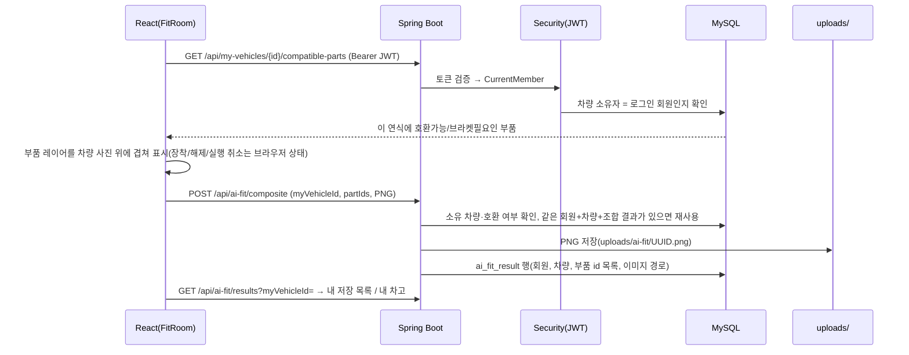

# 아키텍처와 주요 데이터 흐름

## 구성

```
ridefit/
├─ src/main/java/com/ridefit/ridefit/
│  ├─ controller/        REST API (admin/ 하위는 관리자 전용)
│  ├─ service/           비즈니스 로직 (호환성, 장착 결과 저장, 결제, 인기 통계 ...)
│  ├─ repository/        Spring Data JPA
│  ├─ domain/            JPA 엔티티 (Member, MyVehicle, Part, Compatibility, Favorite, AiFitResult ...)
│  ├─ security/          JWT 필터, 인증 실패(401)/권한 거부(403) 응답, CurrentMember
│  └─ config/            시더(DataSeeder, ContentSeeder, VerifiedPartsSeeder), 정적 리소스(/uploads/**)
├─ frontend/
│  ├─ src/pages/         화면(FitRoom, Garage, PartsSearch, PartDetail ...)
│  ├─ src/components/    VehicleFitStage(2D 무대), Vehicle360Viewer, FitSavePanel, AiFitPanel ...
│  ├─ src/constants/     vehicleFitPositions.js(차종별 레이어·부착 좌표), vehicle360Parts.js(각도별 레이어)
│  ├─ src/lib/           api.js(JWT 헤더), fitComposite.js(저장용 Canvas 합성), fitBadges.js(배지 겹침 계산)
│  └─ public/assets/     차량 사진, 360 프레임, 부품 사진, 투명 부품 레이어
└─ tools/                fit-360(360 부품 레이어 제작), wheel-fit(휠 레이어 제작) 스크립트
```

## 요청 흐름



## 주요 개념

| 개념 | 저장 위치 | 설명 |
| --- | --- | --- |
| 호환성 | `compatibility`(부품 × 연식) | 호환가능 / 브라켓필요 / 호환불가 + 근거 메모. 장착 후보는 호환가능·브라켓필요만. 화면은 "호환가능 + 메모 없음"을 "호환 근거 미확인"으로 구분(`lib/compatStatus.js`, 판정 데이터는 그대로) |
| 부품 충돌 | `part_conflict` | 함께 달 수 없는 부품 조합(예: 캐리어 + 스크린 마운트 간섭) |
| 현재 구성 | 브라우저 localStorage(차량별) | FitRoom에서 마지막으로 켜 둔 부품. 서버 데이터 아님 |
| 즐겨찾기 | `favorite`(회원, 부품, 차량) | 사용자가 직접 ♡ 저장한 부품만. 저장한 장착 모습과 별개 |
| 저장한 장착 모습 | `ai_fit_result` + `uploads/ai-fit/` | 직접 합성 PNG와 부품 id 목록. 삭제 시 파일도 정리(다른 결과가 같은 파일을 쓰면 유지) |
| 판매처 가격 | `seller_listing` | 판매처·상품명·가격·확인일·상품 링크. `.test` 도메인은 "예시 데이터"로 표시하고 비교에서 제외 |

## 2D 장착 무대

- 차종 대표 사진마다 `VEHICLE_FIT_LAYOUTS`에 사진 크기, 부품 레이어 배치(`overlays`), 레이어 없는 부품의 부착 지점(`anchors`)을 둔다.
- 레이어는 차량 사진과 같은 캔버스의 투명 PNG라 % 좌표로 변환하면 화면 크기와 상관없이 위치가 맞는다.
- 레이어가 없는 부품은 부착 지점 + 연결선 + "장착 이미지 준비 중" 배지로 표시하고, 화면에서 배지가 겹치면 `lib/fitBadges.js`가 묶는다.
- 저장 이미지는 같은 배치 표로 차량 원본 해상도에 다시 그린다(`lib/fitComposite.js`) - 화면과 저장 결과가 같다.

## 360° 보기

- 차종별 8각도 프레임 + 부품별 각도 레이어. 각도마다 "레이어 경로" 또는 "이 각도에서는 안 보임(null)"을 명시하고,
  8각도가 모두 정해진 부품만 360° 레이어로 쓴다(일부만 있으면 "360° 장착 이미지 준비 중" 안내).
- 레이어 제작 방법과 실측값은 `tools/fit-360/README.md`.

## 권한

- 회원 식별은 JWT의 회원 id만 사용한다(요청 본문의 회원 id를 믿지 않음).
- 내 차량·즐겨찾기·저장 결과·결제 API는 서버에서 소유자를 확인하고, 다른 회원 데이터는 403 또는 404로 응답한다.
- `/api/admin/**`는 ADMIN 역할만. 일반 회원은 403(로그인 만료와 구분).
- 개발용 데모 계정(비밀번호가 코드에 공개됨)은 `ridefit.seed.demo-accounts=true`일 때만 시드한다(기본 false). 관리자 지정은 `ridefit.seed.admin-emails`에 적은 기존 회원만.
- 업로드는 10MB 제한(초과 시 413), PNG/JPG/GIF는 실제 이미지로 읽히는지 확인한다.
