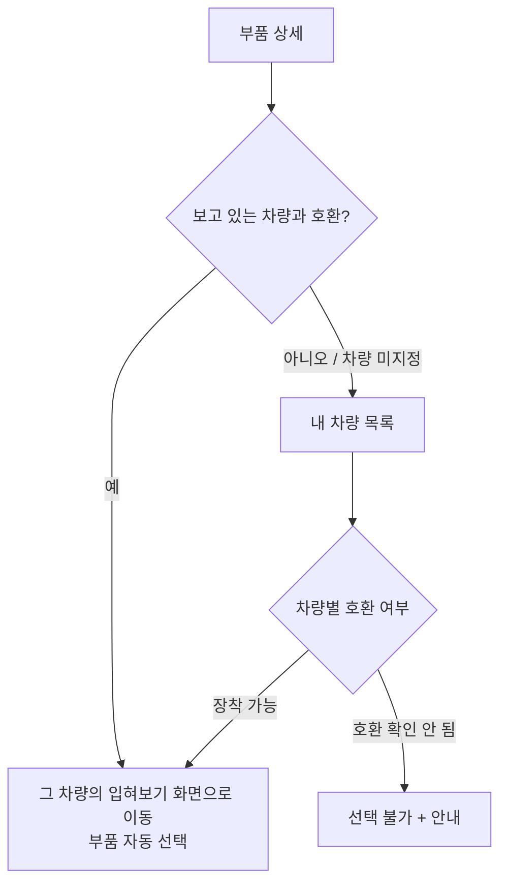
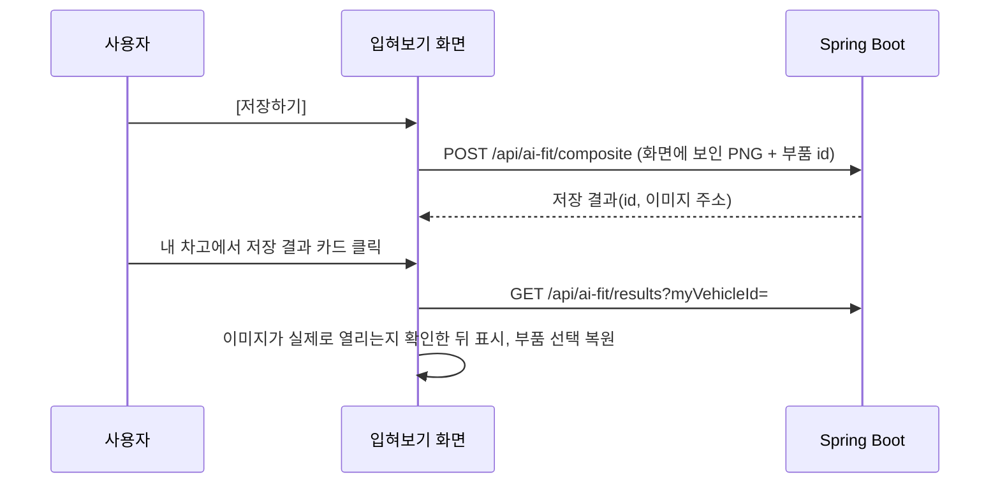

# 주요 기능 흐름

README의 [사용자 이용 흐름](../README.md#사용자-이용-흐름)을 화면 단위로 자세히 적은 문서입니다. 근거 코드는 각 항목 끝에 적었습니다.

## 1. 부품 상세 → 내 차에 장착해보기

- 부품 상세는 차량 기준 상세 요청을 **한 번만** 보내고, 같은 화면에서 `/api/parts/{id}/check`로 판정(호환가능 / 브라켓필요 / 호환불가 / 정보없음)을 받아 표시합니다.
- 차량 목록은 `GET /api/my-vehicles/compatible-summary`로 차량별 호환 여부를 표시하고, 호환이 확인되지 않은 차량은 고를 수 없습니다.
- 주소(`/garage/{id}/fit?partId=`)로 직접 들어와도, 그 차량의 호환 후보에 없는 부품은 선택하지 않고 안내만 보여 줍니다.

근거: `pages/PartDetail.jsx`, `components/FitVehiclePicker.jsx`, `pages/FitRoom.jsx`

## 2. 부품 입혀보기(FitRoom)

### 버튼 역할

| 버튼 | 하는 일 |
| --- | --- |
| **선택** | 부품을 선택 목록에 넣습니다. 이 단계에서는 차량 이미지가 바뀌지 않습니다. 같은 자리(카테고리) 부품은 하나만 선택되고 기존 것과 교체됩니다. |
| **입혀보기** | 지금 선택한 부품 전체를 차량 이미지에 그린 결과를 만듭니다. 차량 아래, 부품 목록 위쪽, 선택한 부품 패널, 모바일 하단 바에 같은 버튼이 있습니다. |
| **저장하기** | 화면에 보이는 결과 이미지와 부품 구성을 저장합니다. 결과가 지금 선택과 같을 때만 누를 수 있습니다. |
| **초기화** | 선택과 결과를 비웁니다. 저장된 결과는 지우지 않고, 실행 취소로 선택을 되돌릴 수 있습니다. |

### 왼쪽 화면의 상태

| 상태 | 화면 | 안내 |
| --- | --- | --- |
| 선택 없음 | 원본 차량 | 부품을 선택하고 [입혀보기]를 누르라는 안내 |
| 선택했지만 입혀보기 전 | 원본 차량 | "아직 입혀보기 전이라 원본 차량이 보여요" |
| 입혀보는 중 | 진행 표시 | 중복 클릭은 무시 |
| 방금 입혀본 결과 | 결과 이미지 | "상품 이미지를 차량 사진에 배치한 2D 미리보기 · 아직 저장 전" |
| 선택이 바뀜 | 이전 결과를 흐리게 | "이전 선택으로 만든 결과" + [다시 입혀보기], 저장 불가 |
| 저장된 결과를 연 경우 | 저장된 이미지 | "저장된 결과를 불러왔어요(새로 만든 것이 아님)" |
| 실패 | 원본 차량 | 원인 + [다시 시도] / 저장 파일이 없으면 열지 못했다고 안내 |

[원본 / 입혀보기 결과] 버튼으로 결과와 원본 차량을 비교할 수 있습니다.

근거: `lib/useFitComposite.js`, `components/FitResultStage.jsx`, `components/FitSavePanel.jsx`

### 결과 이미지가 만들어지는 방식

- 부품마다 그려지는 이미지 종류가 다릅니다(`constants/vehicleFitPositions.js`의 `getPartLayerKind`).
  - **장착 이미지**: 차량 사진과 같은 캔버스에 맞춰 만든 레이어(앞바구니·사이드백·머플러·휠)
  - **간이(상품 사진)**: 상품 사진의 배경을 지워 장착 자리에 얹은 근사치
  - **간이(일러스트)**: 상품 사진이 없는 부품용 카테고리 그림(실제 제품 모습 아님)
  - **위치 표시만**: 그릴 이미지가 없어 결과에서 빠지고 부착 위치만 표시
- 결과 이미지는 브라우저 Canvas로 차량 원본 해상도에 그린 PNG이며, 저장할 때 이 PNG를 그대로 올립니다(`lib/fitComposite.js`). 외부 이미지 API를 호출하지 않습니다.
- 한 번에 넣을 수 있는 부품은 8개까지입니다(서버 한도와 같음).

### 지원하지 않는 경우

- 2D 배치 정보가 없는 차종(PCX 등)과 사용자가 직접 올린 차량 사진: [입혀보기]가 비활성이고, 이유와 부착 위치만 표시합니다.
- 360° 보기: 입혀본 부품 중 각도별 이미지가 있는 부품(앞바구니·사이드백·머플러·휠)만 반영하고, 나머지는 "360° 장착 이미지 준비 중"으로 표시합니다.

## 3. 저장 → 내 차고 → 다시 열기

- 같은 회원·같은 차량·같은 조합을 다시 저장하면 새 파일을 만들지 않고 기존 결과를 엽니다.
- 다른 차량에서 저장한 결과는 이 차량에서 열지 않습니다.
- 저장할 때 들어간 부품 중 지금은 호환 후보가 아닌 부품이 있으면 선택에서 빼고 안내합니다(이미지는 그대로).
- 삭제는 확인 창을 거치며, 다른 결과가 같은 파일을 쓰지 않을 때만 이미지 파일까지 지웁니다.

근거: `AiFitService.saveComposite`, `AiFitService.deleteResult`, `pages/Garage.jsx`, `pages/FitRoom.jsx`

## 4. 모바일

- 차량 미리보기와 부품 목록이 세로로 이어집니다.
- 목록을 내려 차량이 화면 밖에 있으면 화면 아래에 [입혀보기] 바가 나타나고, 누르면 결과를 만든 뒤 차량 위치로 스크롤합니다.
